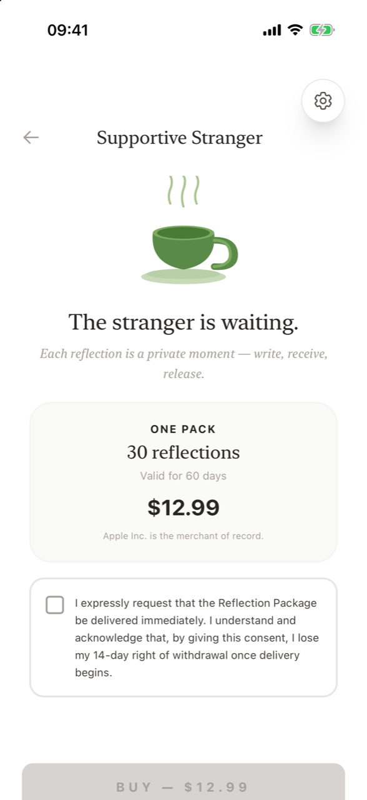

# Buying a Reflection Package

**How do I buy more reflections?** Open the paywall from **Settings → Reflections → Buy**, from **Buy reflections →** on the *No reflections left* screen, or automatically when you send an entry with no balance. Check the consent box, tap **Buy — [price]**, and confirm in Apple's payment sheet. A receipt screen confirms your 30 reflections and their expiry date. Take a screenshot of it for your records.

<figure markdown>
{ .shot loading=lazy }
<figcaption>The Reflection Package</figcaption>
</figure>

## Step by step

1. **Open the package.** The screen reads *The stranger is waiting. Each reflection is a private moment — write, receive, release.* and shows **One pack · 30 reflections · Valid for 60 days**, the price in your currency, and *Apple Inc. is the merchant of record.*
2. **Give your consent.** Tick the box: *"I expressly request that the Reflection Package be delivered immediately. I understand and acknowledge that, by giving this consent, I lose my 14-day right of withdrawal once delivery begins."* The Buy button stays disabled until you tick it. This is required by EU consumer law for digital content that is delivered immediately.
3. **Tap Buy — [price].** Apple's payment sheet opens. Confirm with Face ID, Touch ID or your Apple Account password. If you cancel, nothing is charged.
4. **Read your receipt.** After the purchase, a confirmation screen appears.

## The receipt screen

*Thank you. Your reflections are ready.* The screen shows:

- **Receipt:** Item (30 reflections), Valid until, Price paid, Purchased (date and time), Merchant (Apple Inc.), Apple transaction ID.
- **Confirmation of consent:** the exact consent text you agreed to and the time it was recorded.
- A reminder to **take a screenshot**: it is your receipt. Supportive Stranger does not send purchase emails.
- The provider's details and a link to Apple's refund page.
- **Withdraw from contract here** – the [withdrawal function](withdrawal.md).

Tap **Back to app** to continue where you were.

## Frequently asked questions

### Where is the Buy button?

In Settings under Reflections. It is only active when you have no reflections left or your pack has expired. You'll also see **Buy reflections →** when you try to send an entry without a balance.

### Why do I have to tick a box before buying?

EU law requires your express consent before digital content is delivered immediately. Ticking the box confirms you want your reflections right away and acknowledge that the 14-day withdrawal right ends once delivery begins.

### Will I get a receipt by email?

Apple sends its usual App Store receipt. Supportive Stranger itself does not send purchase emails, so take a screenshot of the in-app receipt screen.

### What payment methods can I use?

Any payment method set up in your Apple Account. The purchase is processed by Apple.

### The purchase failed. Was I charged?

If you see *Purchase could not be verified* or *Purchase failed*, check your Apple purchase history. For billing problems or refunds, use [reportaproblem.apple.com](https://reportaproblem.apple.com) or [contact us](contact.md).
