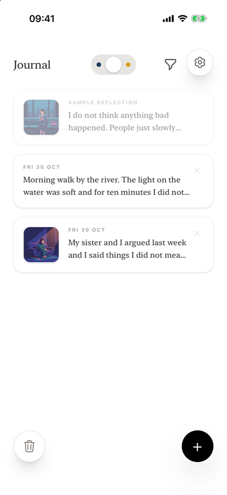
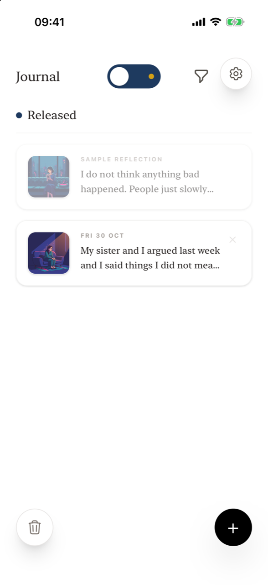
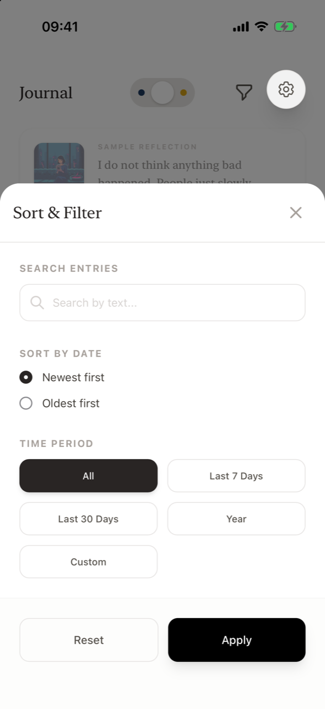
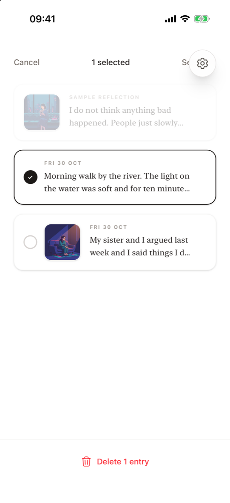
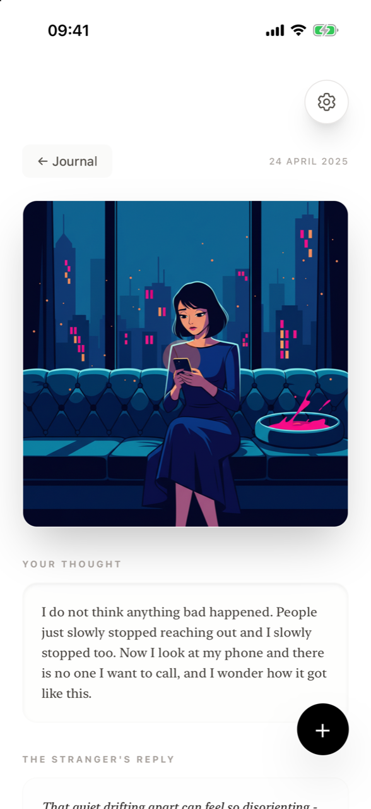
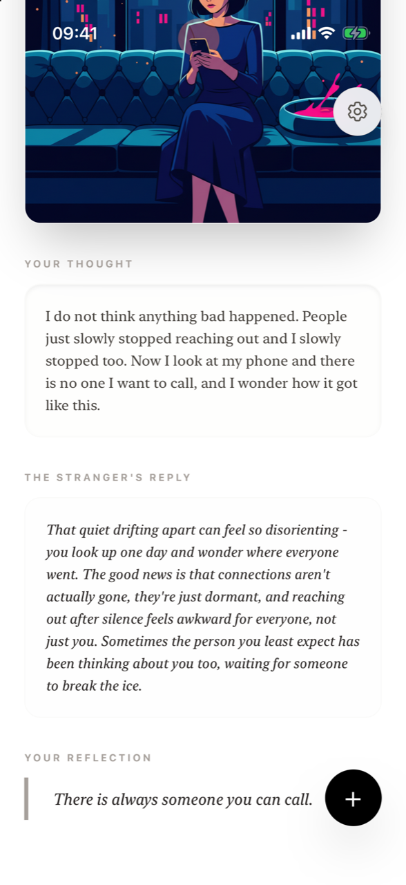

# The journal

**Where are my entries?** All saved entries are in the **Journal**, the screen the app opens on. Tap an entry to read it in full. Use the slider at the top to show **Released** or **Kept** entries, the funnel icon to search, sort and filter, the **×** on an entry to delete it, and the trash button to delete several at once. The journal is stored only on your iPhone.

<figure markdown>
{ .shot loading=lazy }
<figcaption>Journal</figcaption>
</figure>
<figure markdown>
{ .shot loading=lazy }
<figcaption>Released only</figcaption>
</figure>
<figure markdown>
{ .shot loading=lazy }
<figcaption>Sort & Filter</figcaption>
</figure>
<figure markdown>
{ .shot loading=lazy }
<figcaption>Select entries to delete</figcaption>
</figure>

## The journal list

Each entry shows its date (for example *FRI 30 OCT*), the beginning of what you wrote and, if it had a reflection, a thumbnail of its illustration. Newest entries are on top by default.

At the very top is the faded **Sample Reflection**. It is always shown, is not affected by filters, cannot be selected or deleted, and is there to show new users what a finished reflection looks like.

Buttons on this screen:

- **+** (bottom right) – write a new entry.
- **Trash** (bottom left) – select several entries to delete. Appears once you have at least one entry.
- **Funnel** (top) – open **Sort & Filter**. A small dot on it means a search, time period or sort order is active.
- **Gear** – open [Settings](settings.md).

## Released, All, Kept

The pill-shaped slider at the top has three positions:

| Position | Shows | Heading |
|---|---|---|
| Left (deep blue dot) | Entries from *Dark thoughts* | **Released** |
| Middle | Everything | – |
| Right (amber dot) | Entries from *Neutral notes* | **Kept** |

## Sort & Filter

| Option | Choices |
|---|---|
| **Search entries** | Finds text in your entries and in the stranger's replies. |
| **Sort by date** | Newest first · Oldest first |
| **Time period** | All · Last 7 Days · Last 30 Days · Year (since 1 January of the current year) · Custom (pick **From** and **To** dates) |

Tap **Apply** to close the panel, or **Reset** to clear everything. If nothing matches, the journal says *No entries found matching your criteria* and offers **Reset filters**. Your filters stay in place while you open and close entries.

## Reading an entry

Tap an entry to open it. You'll see:

- the date,
- the illustration (or *Illustration was not archived for this entry.* if it was saved without a reflection),
- **Your Thought** – what you wrote,
- **The Stranger's Reply**,
- **Your Reflection** – what you wrote to yourself before releasing (Dark thoughts only).

Tap **← Journal** to go back, or **+** to write a new entry.

<figure markdown>
{ .shot loading=lazy }
<figcaption>Opened entry</figcaption>
</figure>
<figure markdown>
{ .shot loading=lazy }
<figcaption>Reply and your reflection</figcaption>
</figure>

## Deleting entries

- **One entry:** tap the **×** on the entry and confirm *Delete this entry?*
- **Several entries:** tap the **trash** button, tap the entries you want to remove (or **Select all**), then tap **Delete N entries** and confirm. Tap **Cancel** to leave without deleting.

Deleting is permanent. Entries are not stored anywhere else, so they cannot be recovered.

## Frequently asked questions

### Where is my journal stored?

Only on your iPhone, inside the app. It is not uploaded or synced anywhere.

### Can I search my journal?

Yes. Tap the funnel icon and type in **Search entries**. The search looks through your entries and the stranger's replies.

### How do I delete all my entries?

Tap the trash button, then **Select all**, then **Delete N entries**, and confirm. The Sample Reflection stays.

### Can I recover a deleted entry?

No. Entries live only on your device, so once deleted they are gone.

### Why can't I delete the Sample Reflection?

It's a pinned example, not one of your entries. It is always shown so you can see what a finished reflection looks like.

### Will my journal transfer to a new iPhone?

Supportive Stranger has no account or sync, so plan for your journal to stay on the device where you wrote it. Deleting the app or resetting the device deletes the journal.

### Can I edit an entry after saving?

No. Entries can be read and deleted, but not edited.
