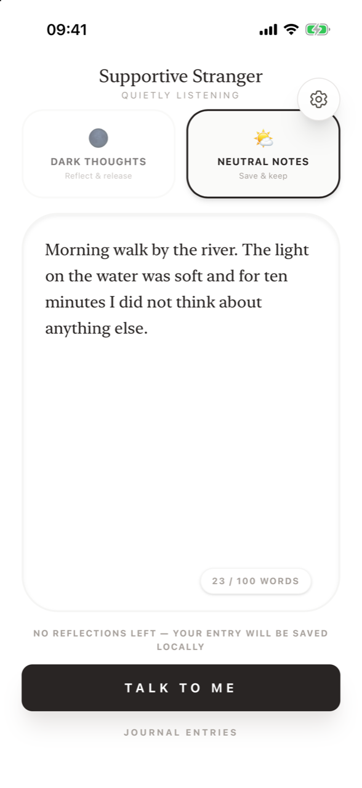

# Dark thoughts and Neutral notes

**What is the difference between the two modes?** **Dark thoughts – Reflect & release** is for something weighing on you: you get a reply and an illustration, write a message to yourself, and then shatter the image to let it go. **Neutral notes – Save & keep** is for a moment you want to keep, such as a good day: you get a reply and an illustration and simply save them. Both use one reflection.

Not everything needs to be burned. Forcing a release on something you wanted to keep, or keeping something you needed to let go, would break the point of the ritual. That's why you choose.

<figure markdown>
{ .shot loading=lazy }
<figcaption>Choose before you write</figcaption>
</figure>

## Side by side

| | **Dark thoughts** 🌑 | **Neutral notes** 🌤 |
|---|---|---|
| Subtitle | Reflect & release | Save & keep |
| Prompt in the text field | *What's weighing on you? Let's reflect and let go of it together.* | *What's making your day good? Let's capture it.* |
| Stranger's reply | Hidden at first, so you find your own words. Available on request with **I don't know what to say**, or after release under **The stranger noticed**. | Shown right away under **Stranger replied**. |
| Writing to yourself | Yes – *What would you tell yourself?* (about 30 characters minimum) | No |
| Ending | Tap to crack, tap again to shatter. *"Your words are saved. The scene is gone."* | Tap **Save entry**. |
| In the journal | Shown under **Released** (deep blue dot) | Shown under **Kept** (amber dot) |
| Uses a reflection | Yes, one | Yes, one |

## The first reflection is always Reflect & release

On first use, the mode cards are hidden and your free reflection uses the full *Reflect & release* path, so you experience the whole ritual once. From then on you choose.

## Frequently asked questions

### Which mode should I choose?

Choose *Dark thoughts* when something is weighing on you and you want to let it go. Choose *Neutral notes* when you want to capture a good or ordinary moment and keep it.

### Do both modes cost the same?

Yes. Each completed reflection (reply plus illustration) uses one reflection, whichever mode you choose.

### Can I change the mode after sending?

No. The mode is set when you tap **Talk to Me**. Go back and write a new entry if you picked the wrong one.

### Why can't I choose a mode for my first entry?

Your free first reflection always uses *Reflect & release* so you can see the complete ritual once. The mode choice appears from your second entry.

### How do I see only released or only kept entries?

Use the three-position slider at the top of the [journal](journal.md): left for **Released**, middle for all, right for **Kept**.
