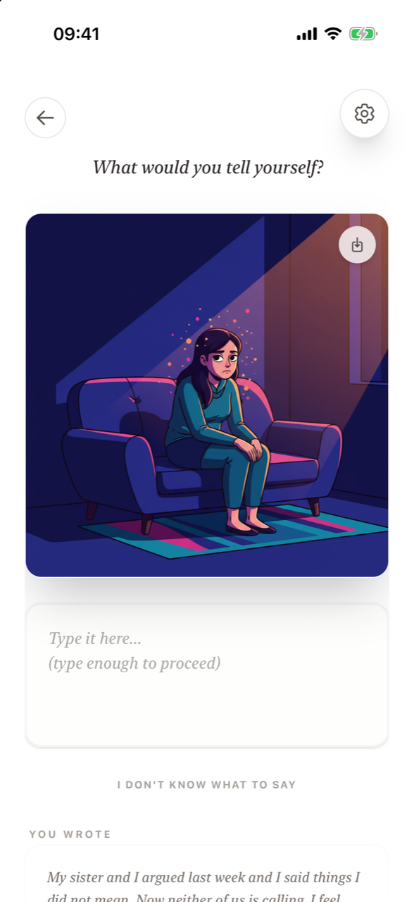
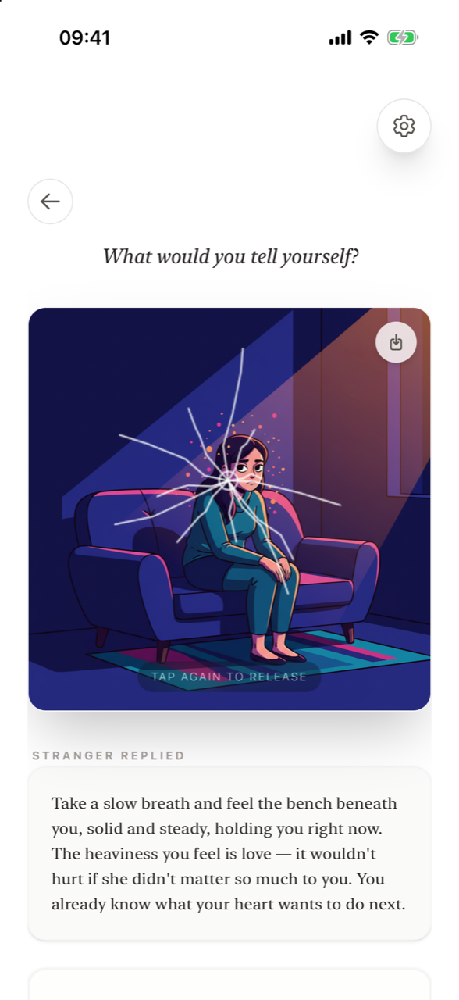
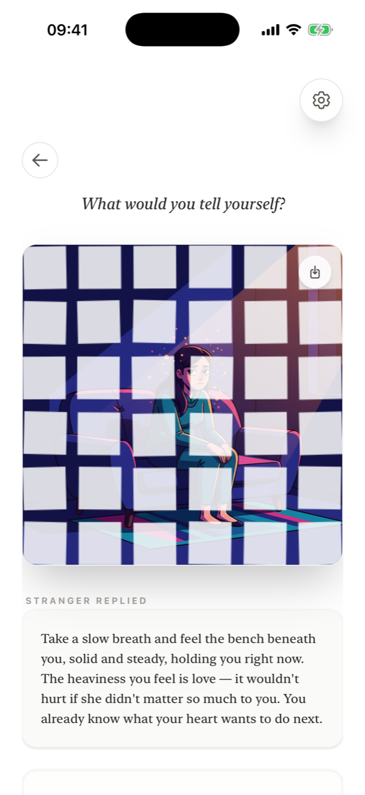
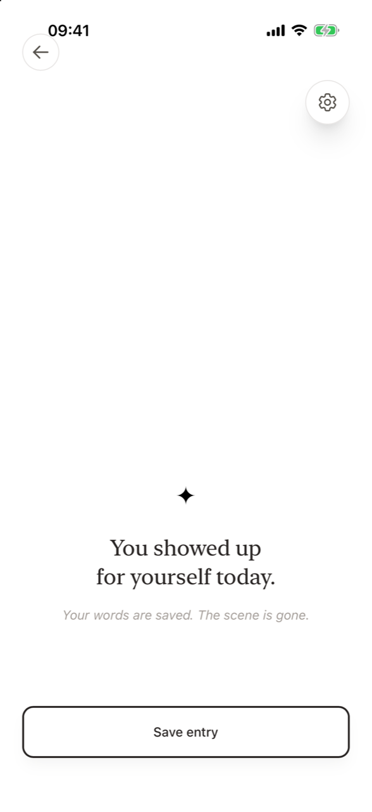

# Reflect and release

**How do I release a thought in Supportive Stranger?** In *Dark thoughts* mode, after the illustration appears, the app shows *Look at the image* and then asks *What would you tell yourself?* Write a short message to yourself (about 30 characters). When **Tap the image to release** appears, tap the scene once – it cracks – and tap again – it shatters and disappears. Then tap **Save entry**.

This deliberate, physical act of letting go is the heart of Supportive Stranger, inspired by the idea of *burn after writing*: the value is not in keeping the record but in the act of letting it go.

## Step by step

1. **Look at the image.** The prompt appears for a moment above the scene.
2. **What would you tell yourself?** A text box appears under the image with *"Type it here... (type enough to proceed)"*.
3. **Write in your own words.** About 30 characters – one short sentence – are enough. Stuck? Tap **I don't know what to say** to read the stranger's reply first, then *"Now try with your own words..."*.
4. **Tap the image to release.** This hint appears once you've written enough.
5. **Crack.** Tap anywhere on the scene. White cracks spread from where you tapped and the label **Tap again to release** appears.
6. **Shatter.** Tap again. The image breaks into pieces that fly apart and fade.
7. **Closing.** *"You showed up for yourself today. Your words are saved. The scene is gone."* If you didn't read the stranger's reply earlier, you can open it under **The stranger noticed**.
8. **Save entry.** Tap the button at the bottom to add the entry to your journal.

<figure markdown>
{ .shot loading=lazy }
<figcaption>What would you tell yourself?</figcaption>
</figure>
<figure markdown>
{ .shot loading=lazy }
<figcaption>First tap: crack</figcaption>
</figure>
<figure markdown>
{ .shot loading=lazy }
<figcaption>Second tap: shatter</figcaption>
</figure>
<figure markdown>
{ .shot loading=lazy }
<figcaption>Your words are saved</figcaption>
</figure>

## Why it is designed this way

- **You have to write first.** You can't release something you haven't engaged with. Writing a few words to yourself is the effort that makes letting go feel earned.
- **Two taps, not one button.** Crack, then shatter. The deliberateness is what gives the gesture weight.
- **The scene is gone from the screen.** Once shattered, the image can't be brought back on that screen. The release is final.

Read more in [Why it works](../why-it-works.md).

## What is kept

Your **words** are kept: the entry, the stranger's reply and what you wrote to yourself appear in your [journal](journal.md) under **Released**, alongside a thumbnail of the scene.

!!! note "Save before you leave"
    The entry is added to your journal when you tap **Save entry**. If you leave the screen before that, the entry is not saved.

## Frequently asked questions

### How much do I need to write before I can release?

About 30 characters – roughly one short sentence. The hint **Tap the image to release** appears once you've written enough.

### Why won't the image crack when I tap it?

You need to write your message to yourself first. Until the text box has enough text, tapping the scene does nothing.

### Can I undo the release?

No. The release is deliberate and final on screen. Your words remain in your journal.

### Can I release a Neutral note?

No. Neutral notes are for keeping. Releasing is only part of *Dark thoughts* mode.

### What is "The stranger noticed"?

After the release, if you didn't open the stranger's reply during the ritual, you can read it by tapping **The stranger noticed**.
