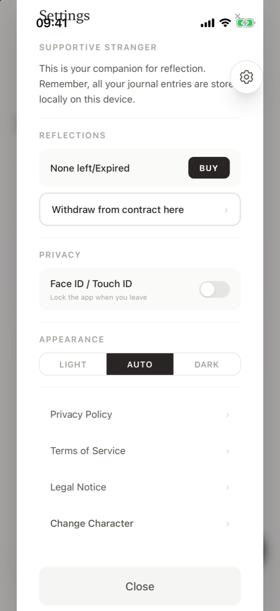
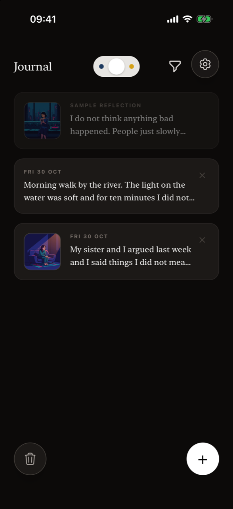

# Settings

**Where are the settings?** Tap the round **gear** button in the top-right corner of any screen. Settings shows how many reflections you have left and when they expire, lets you buy a pack, withdraw from a purchase, lock the app with Face ID or Touch ID, switch between Light, Auto and Dark appearance, read the legal documents and change your character.

<figure markdown>
{ .shot loading=lazy }
<figcaption>Settings</figcaption>
</figure>
<figure markdown>
{ .shot loading=lazy }
<figcaption>Dark appearance</figcaption>
</figure>

## Supportive Stranger

A reminder: *"This is your companion for reflection. Remember, all your journal entries are stored locally on this device."*

## Reflections

- **Balance** – *1 remaining*, *30 remaining*, or *None left/Expired*.
- **Expiry** – while you have reflections from a pack, a line such as *Expires in 42 days* or *Expires tomorrow*.
- **Buy** – opens the [Reflection Package](../buying.md). It is only active when your balance is zero or expired, because you can hold one pack at a time.
- **Withdraw from contract here** – opens the [withdrawal form](../withdrawal.md) for a Reflection Package purchase. It is always available.

## Privacy: Face ID / Touch ID

Switch on **Face ID / Touch ID** (*Lock the app when you leave*) to protect your journal.

- When the app opens, and every time you come back to it, it shows *Your journal is locked* and asks for Face ID or Touch ID.
- If biometrics fail, you can use your iPhone passcode, or tap **Unlock** to try again.
- Face ID or Touch ID must be set up in iOS Settings first. Otherwise the app says *"Face ID / Touch ID is not set up on this device. Enable it in iOS Settings first."*

## Appearance

Choose **Light**, **Auto** or **Dark**. *Auto* follows your iPhone's appearance setting and is the default.

## Legal documents and character

- **Privacy Policy**, **Terms of Service**, **Legal Notice** – read the full text. Tap **Close** to return.
- **Change Character** – choose the Female or Male figure for future illustrations.

Tap **Close** or the **✕** to leave Settings.

## Frequently asked questions

### How do I see how many reflections I have left?

Open Settings (gear icon). The Reflections section shows your balance and, for a purchased pack, how many days are left before it expires.

### How do I lock Supportive Stranger with Face ID?

Open Settings and switch on **Face ID / Touch ID**. The app will ask for Face ID, Touch ID or your passcode each time you open it or return to it.

### Does Supportive Stranger have a dark mode?

Yes. In Settings → Appearance choose **Dark**, or **Auto** to follow your iPhone.

### Why is the Buy button greyed out?

You still have reflections in your current pack. You can buy a new pack once your reflections are used up or have expired.

### How do I change my character?

Open Settings and tap **Change Character**, then pick Female or Male and confirm.

### Is there a way to reset or delete all my data?

Delete all entries from the journal (trash button → **Select all** → delete). Deleting the app removes everything stored on the device.
