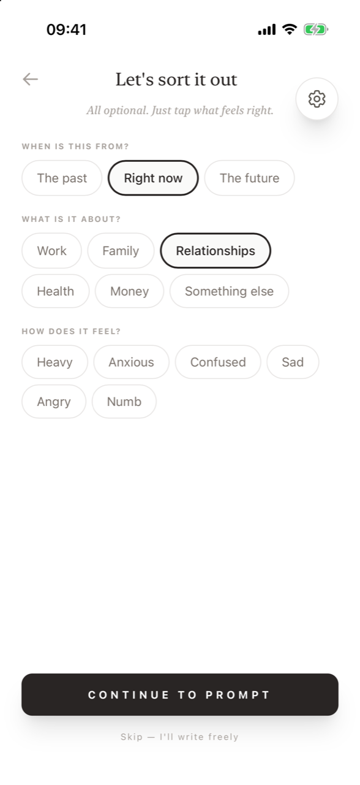
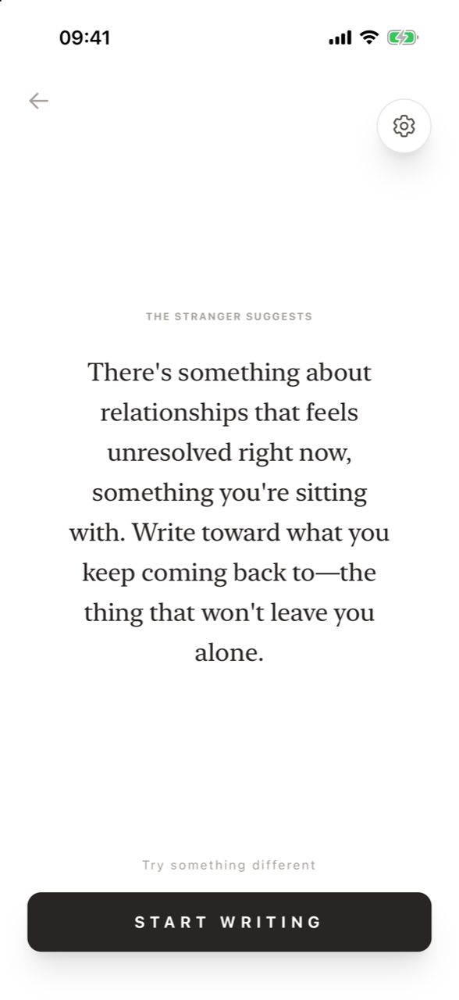

# Don't know where to start?

**What if I don't know what to write?** Tap **Don't know where to start?** above the text field. On **Let's sort it out**, optionally tap when it is from, what it is about and how it feels, then tap **Continue to prompt**. The stranger suggests a short, open writing prompt. Tap **Start writing** and the prompt appears in your text field as a guide. Getting a prompt does not use a reflection.

<figure markdown>
{ .shot loading=lazy }
<figcaption>Let's sort it out</figcaption>
</figure>
<figure markdown>
{ .shot loading=lazy }
<figcaption>The stranger suggests</figcaption>
</figure>

## Step 1: Sort it out (all optional)

*"All optional. Just tap what feels right."* Tap one option per group, tap it again to unselect, or leave a group empty.

| Question | Options |
|---|---|
| **When is this from?** | The past · Right now · The future |
| **What is it about?** | Work · Family · Relationships · Health · Money · Something else |
| **How does it feel?** | Heavy · Anxious · Confused · Sad · Angry · Numb |

Then tap **Continue to prompt**, or **Skip — I'll write freely** to go straight back to the text field.

## Step 2: The stranger suggests

The next screen shows **The stranger suggests** and a prompt written for your choices, for example: *"There's something about relationships that feels unresolved right now, something you're sitting with. Write toward what you keep coming back to."*

- **Try something different** – asks for another prompt. You can do this up to two more times; after the third prompt the app says *"Take a moment with this one."*
- **Start writing** – returns to the writing screen with the prompt shown in the text field. It disappears as soon as you start typing.
- **Back arrow** – returns to your choices.

## How prompts are written

Prompts help you **locate** what is already there; they never suggest *what* you should feel or write. A leading question ("What are you grateful for?") pulls you toward a socially acceptable answer. Supportive Stranger's prompts only point you toward the topic and the feeling you chose.

Your choices on this screen are used only to write the prompt. They are **not** used for the illustration, which is created from your own words alone, so your scene isn't a stereotype of a category.

## Frequently asked questions

### Does asking for a prompt use a reflection?

No. Prompts are free. A reflection is used only when you send your entry and receive the reply and illustration.

### How many prompts can I get?

Three in a row for the same choices: the first one plus two more with **Try something different**. Go back and change your choices to start again.

### Do I have to answer all three questions?

No. Every question is optional. You can continue with none, one, two or all three selected.

### Why don't I see "Don't know where to start?"

It is hidden when you have no reflections left. Buy a Reflection Package to use prompts and replies again, or write freely and save your entry.

### Are my choices saved with my entry?

No. They only shape the suggested prompt and are not stored in your journal or used for the illustration.
