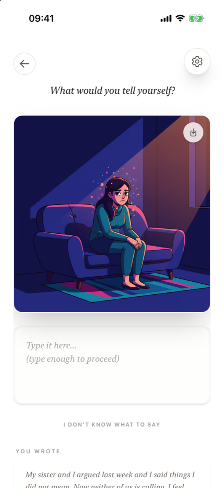

# The illustration

**What is the illustration?** For each reflection, Supportive Stranger creates an image from your own words: a scene with your character in a setting that carries the mood of what you wrote. It shows the feeling from the outside, so you can look at it instead of being inside it. You can share or save the image with the button in its corner.

<figure markdown>
{ .shot loading=lazy }
<figcaption>A scene made from the entry's words</figcaption>
</figure>

## How it is made

- **From your words only.** The image is based on the text you wrote. The options you might have tapped on [Let's sort it out](sort-it-out.md) are never used for the picture, because category labels lead to clichés.
- **With your character.** The figure in the scene matches the character you chose (Female or Male). Change it any time in **Settings → Change Character**.
- **A scene, not an abstraction.** You see a figure in a place, at a small distance – yourself, observed from the outside. The recognition – *"yes, that's how it feels"* – is the point.
- **Universal, not literal.** The scene captures the emotional atmosphere of your words rather than a literal depiction of your circumstances or demographics.

## Sharing or saving the image

Tap the small button in the top-right corner of the image to open the iOS share sheet. From there you can save the picture to Photos or Files, or send it to someone. In *Dark thoughts* mode the button is available until you release the scene.

## In your journal

Saved entries show a thumbnail of their illustration in the journal list and the full image when you open the entry. Entries saved without a reflection have no image; the entry page then says *Illustration was not archived for this entry.*

## Frequently asked questions

### Is the illustration made by AI?

Yes. It is generated by AI from the words of your entry, with the character you selected.

### Why doesn't the picture look exactly like my situation?

The scene is meant to carry the feeling, not to document the facts. It shows the emotional atmosphere of your words in a universal way.

### Can I change the person in the illustrations?

Yes. Open Settings and tap **Change Character** to choose between the Female and Male figure. New illustrations use your new choice.

### How do I save an illustration to my photos?

Tap the share button in the corner of the image and choose **Save Image** in the iOS share sheet.

### What if the image doesn't load?

If the illustration can't be created, the reflection is not counted. Go back and try again.
