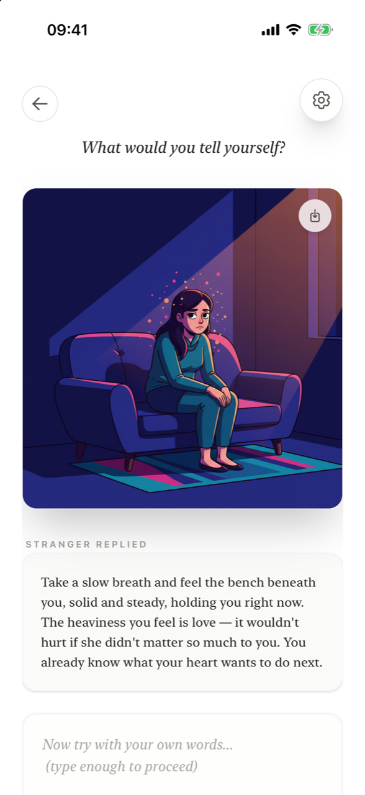

# The stranger's reply

**Who is the stranger?** The stranger is an AI that answers each entry with a short, warm reply. It reflects back what you are feeling, without judging you and without telling you what to do. It is anonymous and has no memory of you: every reflection starts fresh. It is not a person, a therapist or a companion.

<figure markdown>
{ .shot loading=lazy }
<figcaption>The reply under the scene</figcaption>
</figure>

## Why a stranger?

People sometimes find it easier to confide in a stranger on a train than in someone close to them. A stranger has no stake in your life, won't bring it up later and doesn't need looking after. Supportive Stranger recreates that safety:

- **No memory.** The stranger only sees the entry you just wrote. It doesn't know your earlier entries.
- **No identity.** You never give your name, and there is no account. You don't have to protect an image of yourself.
- **No advice.** The stranger witnesses and reflects – in the spirit of *"I notice you showed up here and told me something true"* – rather than prescribing solutions.

The stranger is also designed **not** to become something you depend on. It is a tool for a moment of relief. When the ritual ends, so does the conversation.

## Where the reply appears

- **Neutral notes:** right away, under **Stranger replied**, together with the illustration. While it is still being written, you see *Finding the right words…* and the button reads **Waiting for stranger...**.
- **Dark thoughts:** hidden at first, so that you look for your own words. If you're stuck, tap **I don't know what to say** under the text box; the reply appears and the box changes to *"Now try with your own words..."*. If you didn't ask for it, you can read it after the release by tapping **The stranger noticed**.
- **In your journal:** every saved entry shows the reply under **The Stranger's Reply**.

## Limits of the reply

The reply is generated by AI. It can occasionally be inaccurate, miss a nuance or feel off. It is not medical, psychological or legal advice, and nobody monitors the conversation. If you are in crisis, please see [Safety and wellbeing](../safety.md).

If something fails, the screen shows *Failed to connect to stranger*. No reflection is used unless both the reply and the illustration were delivered.

## Frequently asked questions

### Is the supportive stranger a real person?

No. The stranger is an AI. No human reads or answers your entries.

### Does the stranger remember my previous entries?

No. Each reflection is independent. The stranger only responds to the entry you just sent.

### Will the stranger give me advice?

No. The stranger reflects your feelings back to you with warmth instead of telling you what to do.

### Can I chat back and forth with the stranger?

No. There is one reply per entry. Supportive Stranger is a short ritual, not an open-ended chat.

### Which AI is used?

Supportive Stranger uses third-party AI services to write the reply and create the illustration. The [Privacy Policy](https://supportive-stranger-app.com/#privacy-policy-app) explains how your text is processed.
