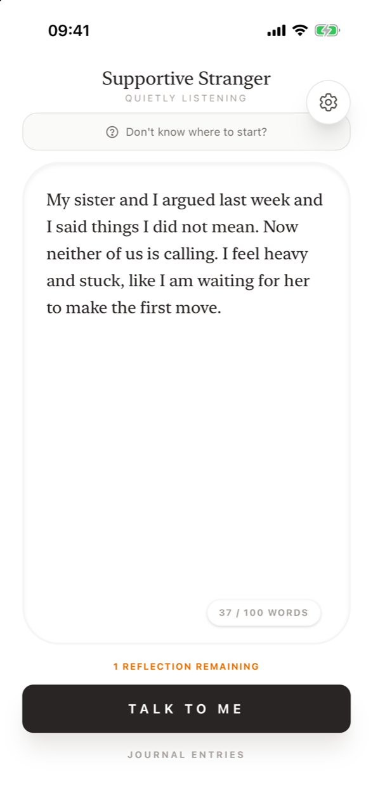
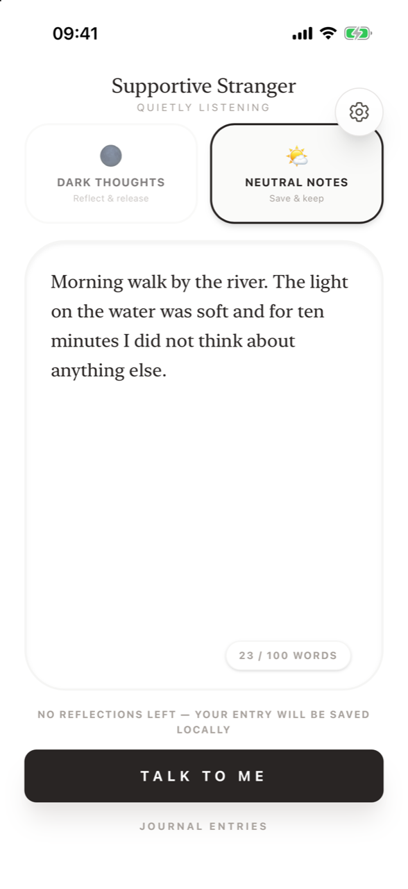
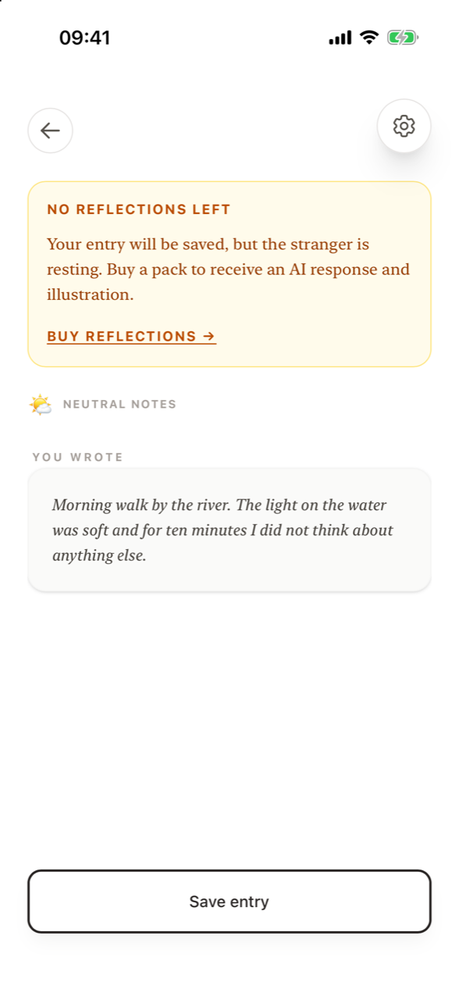

# Writing an entry

**How do I write an entry?** Tap **+** in your journal, choose *Dark thoughts* or *Neutral notes*, type up to 100 words in the large text field and tap **Talk to Me**. A counter in the corner shows how many words you have used. If you are stuck, tap **Don't know where to start?** for a prompt.

<figure markdown>
{ .shot loading=lazy }
<figcaption>The writing screen</figcaption>
</figure>
<figure markdown>
{ .shot loading=lazy }
<figcaption>Choosing a mode</figcaption>
</figure>

## What's on the writing screen

| Element | What it does |
|---|---|
| **Supportive Stranger – Quietly listening** | The screen title. |
| **Mode cards** | **Dark thoughts – Reflect & release** or **Neutral notes – Save & keep**. Pick one before sending. Hidden during your free first reflection, which always uses *Reflect & release*. See [Modes](modes.md). |
| **Don't know where to start?** | Opens [Let's sort it out](sort-it-out.md), which suggests a writing prompt. Only shown while you have reflections available. |
| **Text field** | Where you write. The grey placeholder text depends on the mode: *"What's weighing on you? Let's reflect and let go of it together."* for Dark thoughts, *"What's making your day good? Let's capture it."* for Neutral notes. If you asked for a prompt, the prompt appears here instead. |
| **Word counter** | Shows `n / 100 WORDS`. It turns red at 100. |
| **Talk to Me** | Sends your entry. Disabled until you have written something and chosen a mode. |
| **Journal Entries** | Goes back to your [journal](journal.md). |
| **Gear icon** | Opens [Settings](settings.md). It is available on every screen. |

## Why the 100-word limit?

The entry is meant to be the first honest sentence, not a full diary page. A short limit lowers the barrier to starting and keeps you close to the feeling instead of narrating around it. If you go over 100 words, the button changes to **Too many words** until you shorten the text.

## Messages you may see under the text field

- **Select the mood first** – you have written something but not picked a mode.
- **Too many words** – your entry is longer than 100 words.
- **3 reflections remaining** (in amber) – a reminder when you have three or fewer reflections left.
- **No reflections left — your entry will be saved locally** – you can still write and save, but there will be no reply or illustration. See [Pricing and reflections](../pricing.md).

## Writing when you have no reflections left

You can always write. When your balance is zero (or your pack has expired), tapping **Talk to Me** opens a screen that says *"Your entry will be saved, but the stranger is resting."* Tap **Save entry** to keep your words in the journal, or **Buy reflections →** to open the Reflection Package.

<figure markdown>
{ .shot loading=lazy }
<figcaption>Saving without a reflection</figcaption>
</figure>

## Frequently asked questions

### How many words can I write in one entry?

Up to 100 words. The counter in the corner of the text field shows your word count.

### Why is the Talk to Me button greyed out?

Either the text field is empty, your entry is over 100 words, or you haven't chosen *Dark thoughts* or *Neutral notes* yet.

### Can I write an entry without using a reflection?

Yes. When you have no reflections left, your entry is saved to your journal without a reply or illustration. Writing and saving is always free.

### Is there a draft or autosave?

No. An entry is saved to your journal only when you tap **Save entry** at the end of the flow. If you leave the writing screen before sending, the text is not kept.

### Can I use the app in a language other than English?

The app's interface is in English.
