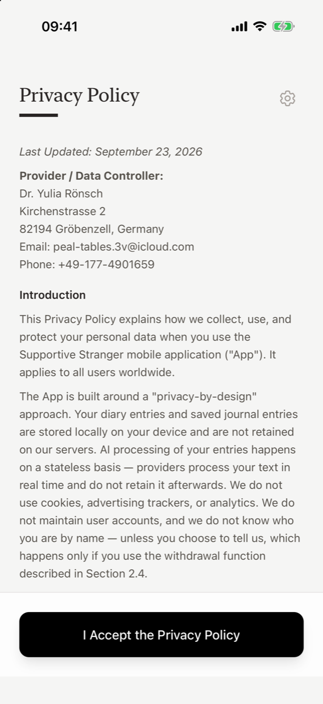
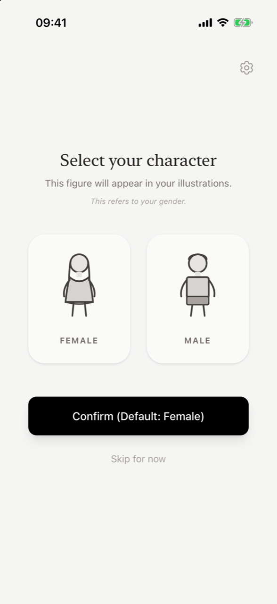
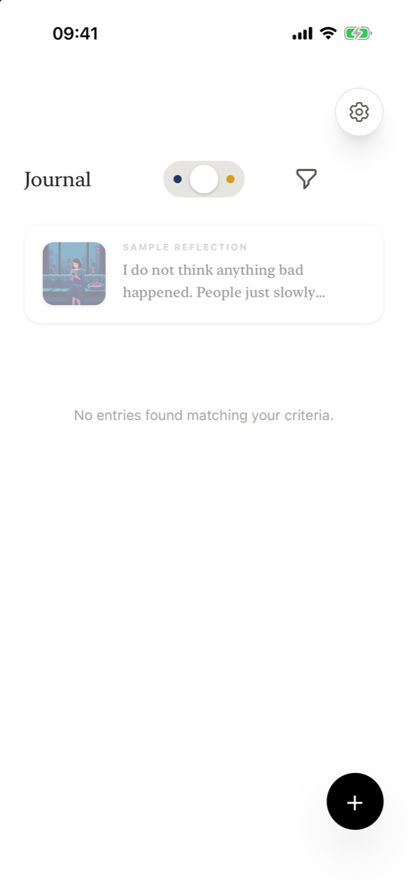
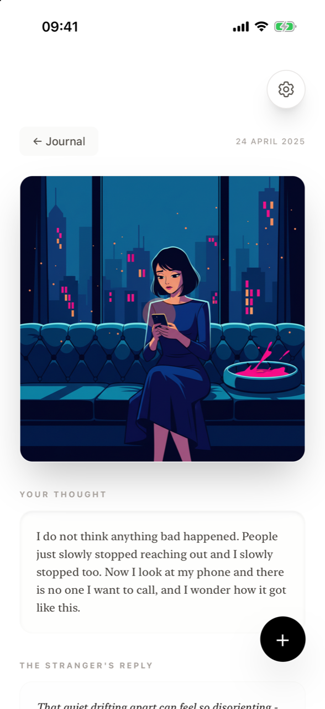
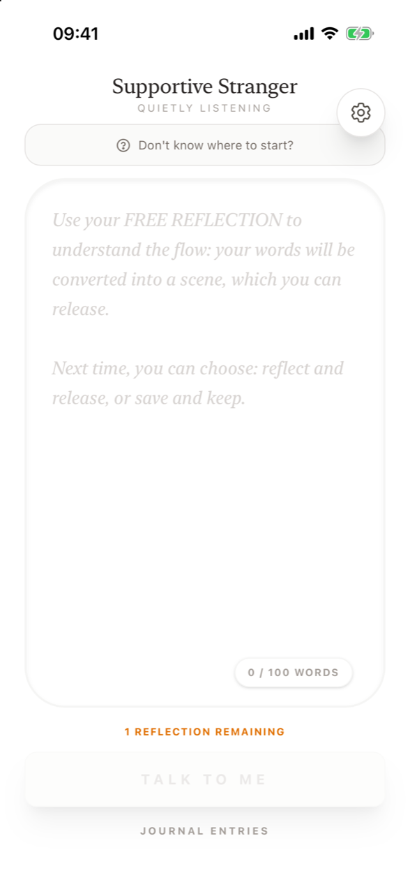

# First launch

**How do I get started with Supportive Stranger?** Install the app from the [App Store](https://apps.apple.com/de/app/supportive-stranger/id6760293353?l=en-GB), open it, accept the Privacy Policy and Terms of Service, confirm you have read the Legal Notice, and pick the character that will appear in your illustrations. You then land in your journal with one free reflection ready to use. No account or sign-up is needed.

## 1. Read and accept the legal documents

The first three screens show the full text of each document, one at a time:

1. **Privacy Policy** – tap **I Accept the Privacy Policy**.
2. **Terms of Service** – tap **I Accept the Terms of Service**.
3. **Legal Notice** – tap **I have read the Legal Notice**.

You can reread all three at any time from [Settings](features/settings.md). The Privacy Policy is also published at [supportive-stranger-app.com](https://supportive-stranger-app.com/#privacy-policy-app).

A gear icon in the top corner opens Settings even during setup, for example if you want to switch to dark mode first.

<figure markdown>
{ .shot loading=lazy }
<figcaption>The first of three legal screens</figcaption>
</figure>
<figure markdown>
{ .shot loading=lazy }
<figcaption>Choosing your character</figcaption>
</figure>

## 2. Select your character

The app asks you to **Select your character**: *Female* or *Male*. This figure represents you in the illustrations the app draws from your words, so you can recognise yourself in the scene.

- Tap a figure, then **Confirm Selection**.
- If you confirm without choosing, or tap **Skip for now**, the female figure is used.
- You can change it later in **Settings → Change Character**.

## 3. Arrive in your journal

After setup, Supportive Stranger opens on the **Journal**. It is empty except for a faded **Sample Reflection** at the top. Tap it to see what a completed reflection looks like: the illustration, the original thought, the stranger's reply and the writer's own reflection. The sample is always there, cannot be deleted, and is not counted as one of your entries.

<figure markdown>
{ .shot loading=lazy }
<figcaption>The journal on first launch</figcaption>
</figure>
<figure markdown>
{ .shot loading=lazy }
<figcaption>The sample reflection</figcaption>
</figure>

## 4. Use your free reflection

Tap the **+** button to write. Your first reflection is free and always follows the full *reflect and release* path, so you experience the whole ritual once. The writing field explains this:

> Use your FREE REFLECTION to understand the flow: your words will be converted into a scene, which you can release. Next time, you can choose: reflect and release, or save and keep.

From the second entry on, you choose between [Dark thoughts and Neutral notes](features/modes.md) yourself.

<figure markdown>
{ .shot loading=lazy }
<figcaption>Your free reflection</figcaption>
</figure>

Continue with [How a reflection works](how-it-works.md).

## Frequently asked questions

### Do I have to create an account to use Supportive Stranger?

No. There is no account, email or password. The app works anonymously from the first launch.

### Why does the app ask for my gender?

Only to choose the figure drawn in your illustrations, so the scene shows someone like you. You can pick Female or Male, skip (the female figure is used), or change it later in Settings.

### What is the Sample Reflection in my journal?

It is a pinned example that shows what a finished reflection looks like. It is always visible, cannot be deleted, is not affected by filters and does not use a reflection.

### Can I read the Privacy Policy and Terms again later?

Yes. Open Settings (gear icon) and tap Privacy Policy, Terms of Service or Legal Notice.
