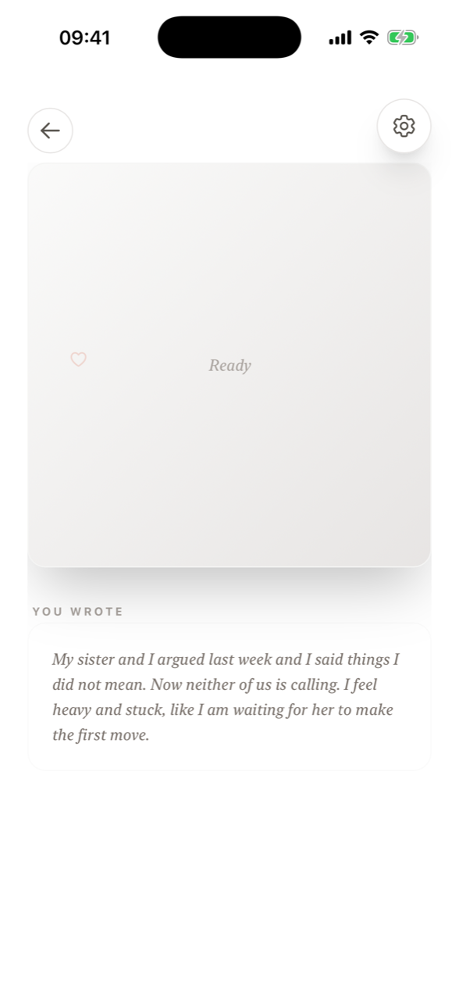
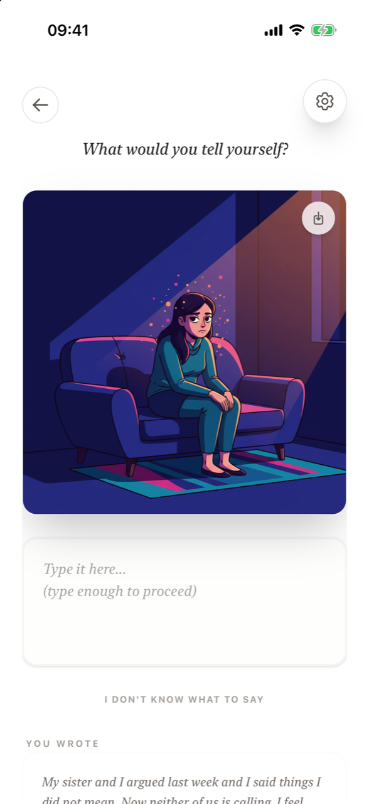
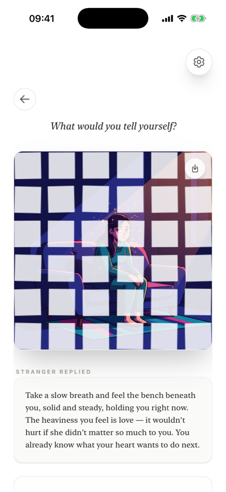

# How a reflection works

**What happens during a reflection?** You write up to 100 words and tap **Talk to Me**. The anonymous stranger writes a short, kind reply and the app paints a scene of your feeling with your character in it. In *Dark thoughts* mode you then answer the question **What would you tell yourself?** in your own words, tap the image once to crack it and once more to shatter it, and see *"Your words are saved. The scene is gone."* In *Neutral notes* mode you simply read the reply, look at the scene, and save it.

A **reflection** is one AI reply plus one illustration. Writing and saving entries without them is always free.

## The four steps

### 1. Name it

Write what is on your mind in up to 100 words. One honest sentence is enough. If you can't find the first sentence, tap [Don't know where to start?](features/sort-it-out.md) for a gentle prompt.

Then tap **Talk to Me**. Details: [Writing an entry](features/writing-an-entry.md).

### 2. Be met

The screen shows *Generating response…* while the stranger writes back and the illustration is painted. This usually takes a few seconds. The reply reflects your feeling back to you warmly. It does not judge you, diagnose you or tell you what to do. Details: [The stranger's reply](features/the-stranger.md).

### 3. See it from the outside

Your words become a scene: your character in a setting that carries the mood of what you wrote. Looking at a feeling from a small distance makes it easier to hold. Details: [The illustration](features/the-illustration.md).

### 4. Release it (Dark thoughts) or keep it (Neutral notes)

- **Dark thoughts – Reflect & release.** The app shows *Look at the image*, then asks *What would you tell yourself?* Write at least a short sentence (about 30 characters). When the hint **Tap the image to release** appears, tap the scene: it cracks. Tap again: it shatters and is gone. Details: [Reflect and release](features/release.md).
- **Neutral notes – Save & keep.** The reply and the image appear together. Read them and tap **Save entry**. Nothing is destroyed.

<figure markdown>
{ .shot loading=lazy }
<figcaption>Generating</figcaption>
</figure>
<figure markdown>
{ .shot loading=lazy }
<figcaption>Look at the image</figcaption>
</figure>
<figure markdown>
{ .shot loading=lazy }
<figcaption>Write to yourself</figcaption>
</figure>
<figure markdown>
{ .shot loading=lazy }
<figcaption>Shatter</figcaption>
</figure>

## When does a reflection count?

A reflection is used only when **both** the reply and the illustration have been created. If something goes wrong and you don't receive both, it is not deducted. When you have no reflections left, you can still write and save entries; they are kept in your journal without a reply or image. See [Pricing and reflections](pricing.md).

## Frequently asked questions

### How long does a reflection take?

Usually a few seconds for the reply and a little longer for the illustration. The whole ritual, including writing and releasing, takes a few minutes.

### What does "Talk to Me" do?

It sends your entry to the stranger. You'll get a written reply and an illustrated scene based on your words. One reflection is used once both have arrived.

### Do I have to release every entry?

No. Releasing is only part of *Dark thoughts* mode. Choose *Neutral notes* when you want to keep a moment instead.

### Is my entry saved after I release the scene?

Yes. Your words are saved in your journal: your entry, the stranger's reply and what you wrote to yourself. Releasing ends the ritual on screen; it does not delete your writing.

### Can I go back while the stranger is replying?

Yes, the back arrow returns to the writing screen. If the reply and illustration were not both delivered, no reflection is used.
