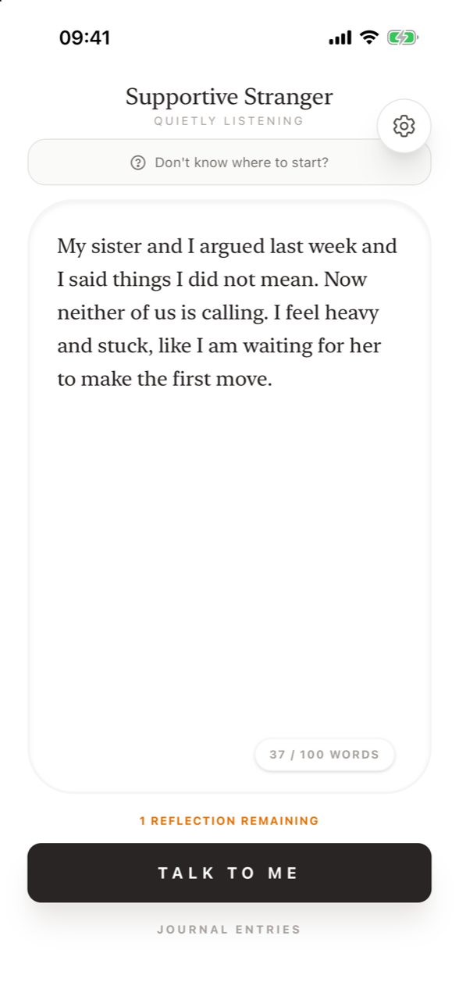
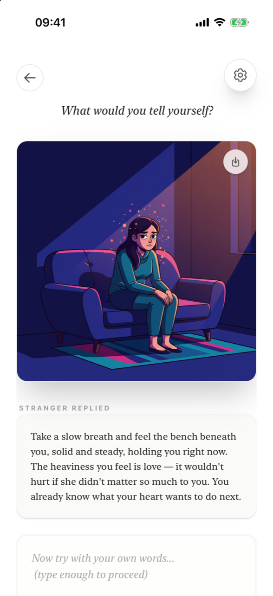
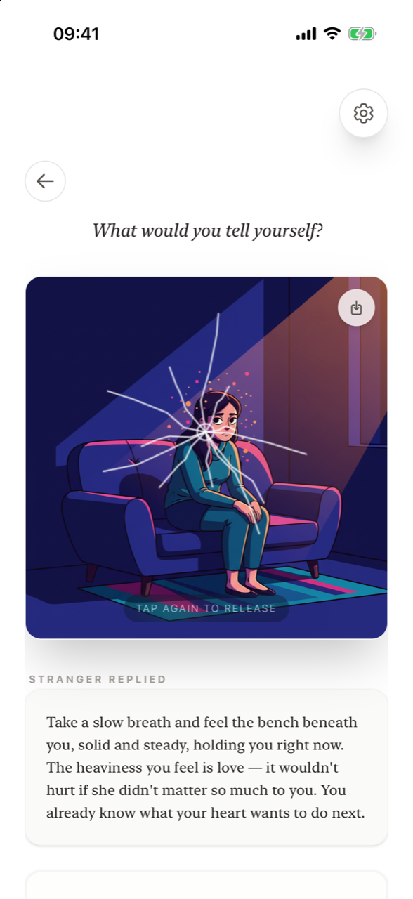
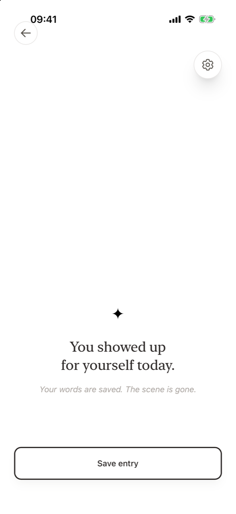

# Supportive Stranger

**A short reflection ritual for iPhone: write, be met, release.**

[Download on the App Store](https://apps.apple.com/de/app/supportive-stranger/id6760293353?l=en-GB){ .app-store } &nbsp; [supportive-stranger-app.com](https://supportive-stranger-app.com)

**What is Supportive Stranger?** Supportive Stranger is an iPhone app for short, private reflection. You write a few honest sentences (up to 100 words) about what is on your mind. An anonymous AI "stranger" answers with a warm, non-judgmental reply and turns your words into an illustrated scene. If it is something heavy, you write a few words to yourself and then deliberately shatter the image to let it go. If it is a good moment, you simply keep it in your journal.

It is not a diary you have to keep up, not a chatbot to talk to for hours, and not therapy. It is a few minutes of relief: name the feeling, be witnessed, see it from the outside, and close the loop.

<figure markdown>
{ .shot loading=lazy }
<figcaption>1. Write what is on your mind</figcaption>
</figure>
<figure markdown>
{ .shot loading=lazy }
<figcaption>2. Be met by the stranger</figcaption>
</figure>
<figure markdown>
{ .shot loading=lazy }
<figcaption>3. Release the scene</figcaption>
</figure>
<figure markdown>
{ .shot loading=lazy }
<figcaption>4. Close the app, lighter</figcaption>
</figure>

## Key facts

| | |
|---|---|
| **Platform** | iPhone (iOS). There is no iPad, Android or web version. |
| **Price to start** | Free download with **one free reflection**. |
| **Reflection Package** | **30 reflections, valid for 60 days**, one-time in-app purchase (for example €14.99 in Germany; the App Store shows the price for your country). No subscription. |
| **Account** | None. No sign-up, no email, no password. |
| **Where your journal lives** | Only on your iPhone. |
| **Entry length** | Up to 100 words. |
| **Two modes** | *Dark thoughts – Reflect & release* and *Neutral notes – Save & keep*. |
| **Privacy lock** | Optional Face ID / Touch ID. |
| **Appearance** | Light, Dark or Auto (follows iOS). |
| **Language** | English. |
| **Age** | 17+. |
| **What it is not** | Not a medical device, not therapy, not a crisis service. See [Safety and wellbeing](safety.md). |

## Where to go next

- New here? Start with [First launch](getting-started.md) and [How a reflection works](how-it-works.md).
- Looking for a specific feature? See [Using the app](features/writing-an-entry.md), or the [FAQ](faq.md).
- Questions about cost? See [Pricing and reflections](pricing.md).
- Curious why it is designed this way? Read [Why it works](why-it-works.md).

## Frequently asked questions

### What does Supportive Stranger do?

It helps you put a feeling into words in under 100 words, gives you a kind reply and an illustration created by AI from your words, and, for difficult thoughts, lets you release them by writing a message to yourself and shattering the image. Everything you write is saved in a private journal on your iPhone.

### Is Supportive Stranger free?

The download is free and includes one free reflection. After that, you can buy a Reflection Package of 30 reflections that is valid for 60 days. Writing and saving journal entries without an AI reply is always free.

### Do I need an account?

No. Supportive Stranger has no accounts, no sign-up and no login. Your journal is stored only on your device.

### Is Supportive Stranger a therapy app?

No. Supportive Stranger is a wellness tool for short moments of reflection. It does not diagnose or treat anything and is not a substitute for professional help. If you are in crisis, contact local emergency services or a crisis line – see [Safety and wellbeing](safety.md).

### Who is the "stranger"?

The stranger is an AI that replies anonymously and kindly, without judging and without giving advice. It has no memory of you between reflections. It is not a person, and it is not a companion meant to replace human connection.
