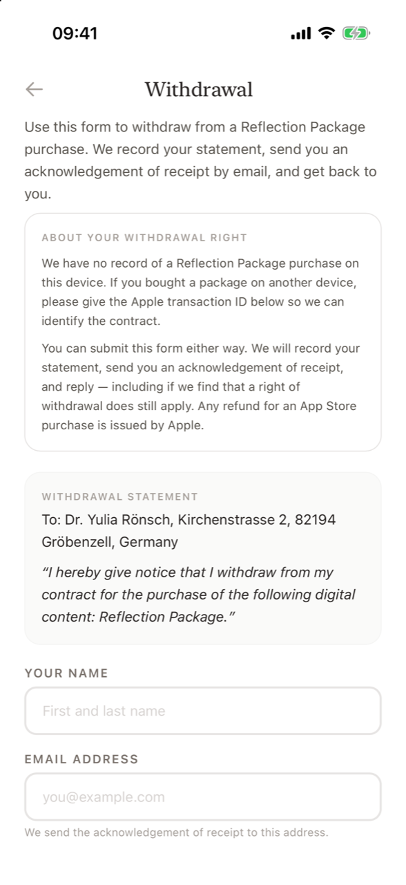

# Withdrawal and refunds

**How do I withdraw from a purchase?** Open **Settings → Withdraw from contract here** (or the same button on the purchase receipt). Enter your name and email address, optionally your Apple transaction ID and purchase date, and tap **Confirm withdrawal**. You get an acknowledgement of receipt in the app and by email. Refunds for App Store purchases are always paid by Apple; you can also request one at [reportaproblem.apple.com](https://reportaproblem.apple.com).

<figure markdown>
{ .shot loading=lazy }
<figcaption>The withdrawal form</figcaption>
</figure>

## Your right of withdrawal, in short

- In the EU, consumers normally have a 14-day right of withdrawal.
- For digital content delivered immediately, that right ends once delivery begins **if** you gave your express consent. When you buy a Reflection Package, the consent box on the purchase screen records exactly this. A withdrawal after such a purchase is therefore unlikely to succeed.
- You can **always** submit the form anyway. Your statement is recorded and answered, including if it turns out that a right of withdrawal does still apply.

The binding rules are in section 12 of the [Terms of Service](contact.md#legal-documents).

## Using the withdrawal form

The form is addressed to the provider and contains the statement *"I hereby give notice that I withdraw from my contract for the purchase of the following digital content: Reflection Package."*

| Field | Required? | Notes |
|---|---|---|
| **Your name** | Yes | First and last name. |
| **Email address** | Yes | The acknowledgement of receipt is sent here. |
| **Apple transaction ID** | Optional | Filled in automatically for a purchase made on this device. Also found on your receipt or in iOS Settings › Apple Account › Purchase History. |
| **Date of purchase** | Optional | Filled in automatically for a purchase made on this device. |
| **Additional information** | Optional | Up to 2,000 characters. |

The box **About your withdrawal right** explains your situation: either the time you gave consent at purchase, or that there is no record of a purchase on this device (for example if you bought on another device – then add the transaction ID).

Tap **Confirm withdrawal**. The screen changes to *Withdrawal received.* with an **Acknowledgement of receipt**: a reference number, the date and time received, your details and the statement you submitted. A copy is sent to your email address. Take a screenshot for your records, then tap **Done**.

You can also withdraw by email using the address shown at the bottom of the form.

## Refunds

Apple is the merchant of record for all purchases. Refunds are requested from and paid by Apple at [reportaproblem.apple.com](https://reportaproblem.apple.com). If Apple refunds a Reflection Package, any remaining reflections from it may be removed from your balance.

## Frequently asked questions

### Where is the withdrawal button?

In Settings, directly under your reflection balance: **Withdraw from contract here**. It is also on the receipt screen after a purchase.

### Do I need to enter my Apple transaction ID?

No, it is optional. If you bought the pack on this device, it is filled in for you. It helps to identify the purchase if you bought it on another device.

### Will a withdrawal get my money back?

If you consented to immediate delivery when buying, the withdrawal right usually ended when delivery began. Your statement is still recorded and answered. Refunds are always issued by Apple.

### How do I request a refund?

Go to [reportaproblem.apple.com](https://reportaproblem.apple.com), sign in with your Apple Account and select the Supportive Stranger purchase.

### What personal data does the withdrawal form collect?

Only what you enter: your name, email address and the optional purchase details and message. This is the only place in the app where you share your name or email. See the [Privacy Policy](https://supportive-stranger-app.com/#privacy-policy-app).
